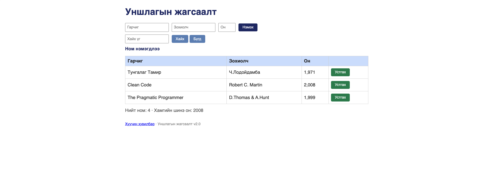

# BUG-05: «Нийт ном» тоолуур хүснэгтэд буй номын тооноос үргэлж 1-ээр илүү харагддаг

Орчин:  Уншлагын жагсаалт v2.0, Chrome v155.0.8059.80, macOS Tahoe 26.6, 2026-10-20
Урьдчилсан нөхцөл: node app.js-ийг шинээр асаасан (анхны 3 ном)

## Дахин гаргах алхам

1. Браузерт `http://localhost:3000` хуудсыг нээ.
2. Хүснэгт дэх номын мөрийг тоол: 3 ном (Тунгалаг Тамир, Clean Code, The Pragmatic Programmer).
3. Хүснэгтийн доорх «Нийт ном» гэсэн мөрийг хар.
4. (Нэмэлт) Гарчиг `A`, Зохиолч `B`, Он `2020` бичээд «Нэмэх» дар. Хүснэгтэд 4 ном болно, «Нийт ном»-ыг дахин хар.
5. (API) `curl -i localhost:3000/api/stats` командыг ажиллуул.

Хүлээгдэж байсан: Спецификацийн дүрэм «"Нийт ном" тоолуур хүснэгтэд буй номын тоотой тэнцүү.» Алхам 3-т «Нийт ном: 3», алхам 4-т «Нийт ном: 4», API-д `"total":3` байх ёстой.

Бодит үр дүн:     Алхам 3-т «Нийт ном: 4», алхам 4-т «Нийт ном: 5» харагдана. Ном нэмэх бүрт зөрүү 1 хэвээр байна. Шинээр асаасан аппад `/api/stats` нь `{"total":4,"newest":2008}` буцаадаг. Session-ий үед 5 ном байхад `"total":6` буцаасан (evidence/bug-19-curl.txt).

Ноцтой байдал: Minor. Хэрэглэгчид харуулж буй статистик үргэлж буруу тул итгэл алдагдана. Гэхдээ ном нэмэх, хайх, устгах үндсэн функцэд саад болохгүй, өгөгдөл алдагдахгүй.

Хавсралт:      screenshots/bug-05.png, screenshots/bug-11.png (UI) · evidence/bug-19-curl.txt (API)

Олдсон аялал:  Supermodel (хүснэгт ба тоолуурыг харьцуулж байхад); API хувилбар нь Saboteur
