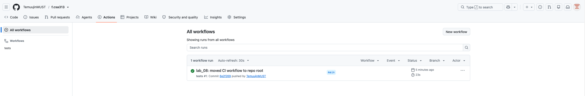

# Лаборатори №8: Mock объектууд — Mockito

- **Нэр:** Г. Тэмүүжин
- **Код:** B232270020

**Java version:**
```
java 17 2021-09-14 LTS
Java(TM) SE Runtime Environment (build 17+35-LTS-2724)
Java HotSpot(TM) 64-Bit Server VM (build 17+35-LTS-2724, mixed mode, sharing)
```

**Maven version:**
```
Apache Maven 3.9.10 (5f519b97e944483d878815739f519b2eade0a91d)
Maven home: /opt/homebrew/Cellar/maven/3.9.10/libexec
Java version: 17, vendor: Oracle Corporation, runtime: /Library/Java/JavaVirtualMachines/jdk-17.jdk/Contents/Home
Default locale: en_MN, platform encoding: UTF-8
OS name: "mac os x", version: "26.6", arch: "aarch64", family: "mac"
```

## Хэсэг A: Найман тест

**Тестийн тоо:** 10 (7 энгийн тест + A8-ийн 3 мөр) — `results/mvn-test.txt`

**A8-ийн `lenient()`:** A8-ийн гурван мөр бүгд ижил stub-уудыг тохируулдаг ч мөр бүр тэдгээрийн зөвхөн заримыг нь ашигладаг (жишээ нь `S404` мөр `courseExists`-д огт хүрдэггүй), тиймээс `lenient()`-гүй бол strict stubs горим гурван мөрийг бүгдийг `UnnecessaryStubbingException`-ээр унагадаг. `lenient()` энэ шалгалтыг зөвхөн A8-ийн stub-уудад унтраадаг тул бусад 7 тестэд strict шалгалт хэвээр үлдэнэ.

## Хэсэг B: Мини мутаци

| Мутант | Кодод хийсэн эвдрэл | Үр дүн | Унасан тестүүд | Унасан шалтгаан |
|---|---|---|---|---|
| 1 (`mvn-test-mutant-1.txt`) | `if (!student.active())` шалгалтыг комментолсон | Failures: 2, Errors: 0, BUILD FAILURE | A3 `register_inactiveStudent_returnsErrorWithoutTouchingEmail`; A8 `register_invalidRequest_returnsExpectedErrorWithoutSavingOrEmailing` (2-р мөр) | A3: `ERROR_INACTIVE_STUDENT` хүлээсэн, `ERROR_NO_COURSE` буцаасан. A8: `ERROR_INACTIVE_STUDENT` хүлээсэн, `OK` буцаасан |
| 2 (`mvn-test-mutant-2.txt`) | `saveRegistration(...)` дуудалтыг комментолсон | Failures: 2, Errors: 0, BUILD FAILURE | A1 `register_activeStudentWithPrerequisites_savesAndSendsEmail`; A5 `register_emailSenderThrows_stillReturnsOkAndSaves` | `verify(repository).saveRegistration(...)`: "Wanted but not invoked" |
| 3 (`mvn-test-mutant-3.txt`) | Эхний `if`-ээс `\|\| courseId == null` хэсгийг устгасан | Failures: 1, Errors: 0, BUILD FAILURE | A6 `register_nullArgument_throwsWithoutTouchingDependencies` | `register("S100", null)` дуудалтад `IllegalArgumentException` шидэгдээгүй |

**Дүгнэлт:** Гурван мутантыг бүгдийг нь тест барьсан, аль ч файлд `UnnecessaryStubbingException` (Errors) гараагүй, бүгд Failures-ээр унасан. Мутант 1-д A3 ба A8 хоёулаа унасан ч буцаасан утга нь өөр байна: A3-т `courseExists` stub хийгээгүй тул `ERROR_NO_COURSE`, A8-д stub хийсэн тул шалгалтууд бүгд давж `OK` буцсан. Мутант 2-т `OK` буцах утга өөрчлөгдөөгүй тул зөвхөн `verify` л эвдрэлийг илрүүлсэн, өөрөөр хэлбэл буцах утгыг шалгах нь хангалтгүй. Мөн A7 энэ мутантад унаагүй, учир нь зөвхөн и-мэйлийг шалгадаг. Мутант 3-ыг эхний оролдлогоор барьсан, учир нь A6 аргумент тус бүрийн null-ийг тусад нь шалгадаг. Иймд тестийг засах шаардлага гараагүй. Хэрэв A6 зөвхөн `studentId`-г шалгасан бол энэ мутант илрэхгүй үлдэх байсан.

## Дүгнэлт

Mockito-гийн mock нь өөрийн логикгүй, тест бүрт зааж өгсөн хариуг буцааж, дуудалтуудыг бүртгэдэг бол гараар бичсэн fake нь интерфейсийн хялбаршуулсан боловч ажилладаг хэрэгжүүлэлт юм. Жишээ нь, энэ лабд `when(repository.findStudent("S100")).thenReturn(ACTIVE)` гэсэн stub, `verify(repository).saveRegistration("S100", COURSE_ID)` гэсэн шалгалт л хангалттай байсан. Харин Лекц 8-ын `FakeRepo` шиг fake бичвэл оюутнуудыг `HashMap`-д хадгалж, `StudentRepository`-гийн дөрвөн методыг бүгдийг хэрэгжүүлэх бөгөөд хадгалалтыг `verify`-гаар биш `saved` жагсаалтын төлөвөөр шалгана. Fake нь олон тестэд дахин ашиглагдаж, дуудалтын хэлбэрээс хамаардаггүй давуу талтай ч, mock нь бичихэд хурдан бөгөөд `doThrow`-оор SMTP-ийн уналтыг нэг мөрөөр дуурайлгадаг. Mock-ийг зөвхөн зааг дээрх хамаарлуудад (сан, сүлжээ, и-мэйл, цаг) хэрэглэх ёстой бөгөөд тестлэж буй класс, өөрийн домэйн логик, `Student` шиг энгийн өгөгдлийн объектыг mock хийх ёсгүй, эс тэгвээс тест зөвхөн mock-оо шалгадаг болно. `verify`-г хэтрүүлж `findStudent`, `courseExists`-ийн дуудалтын тоо, дарааллыг хүртэл шалгавал тест хэрэгжүүлэлтийн дотоод бүтэцтэй уягдаж, зан төлөв өөрчлөгдөөгүй refactor-т ч унах хэврэг болно. Тиймээс би `verify`-г спецификацид заасан гадагш чиглэсэн үйлдлүүдэд (`saveRegistration`, `send`) л хэрэглэсэн бөгөөд мутант 2-ыг барихад энэ нь хангалттай байсан.

## Нэмэлт даалгавар - CI зураг

**CI тайлбар:** GitHub Actions нь workflow файлыг зөвхөн репозиторийн үндсэн хавтасны `.github/workflows/`-оос уншдаг тул `test.yml`-ийг `lab_08/` дотор биш, репозиторийн root-д байрлуулсан. Энэ репод бүх лабораторийн ажил хамт байдаг бөгөөд `pom.xml` нь `lab_08/` дотор байгаа тул `working-directory: lab_08` тохиргоогоор `mvn` командыг тухайн хавтсанд ажиллуулдаг.

