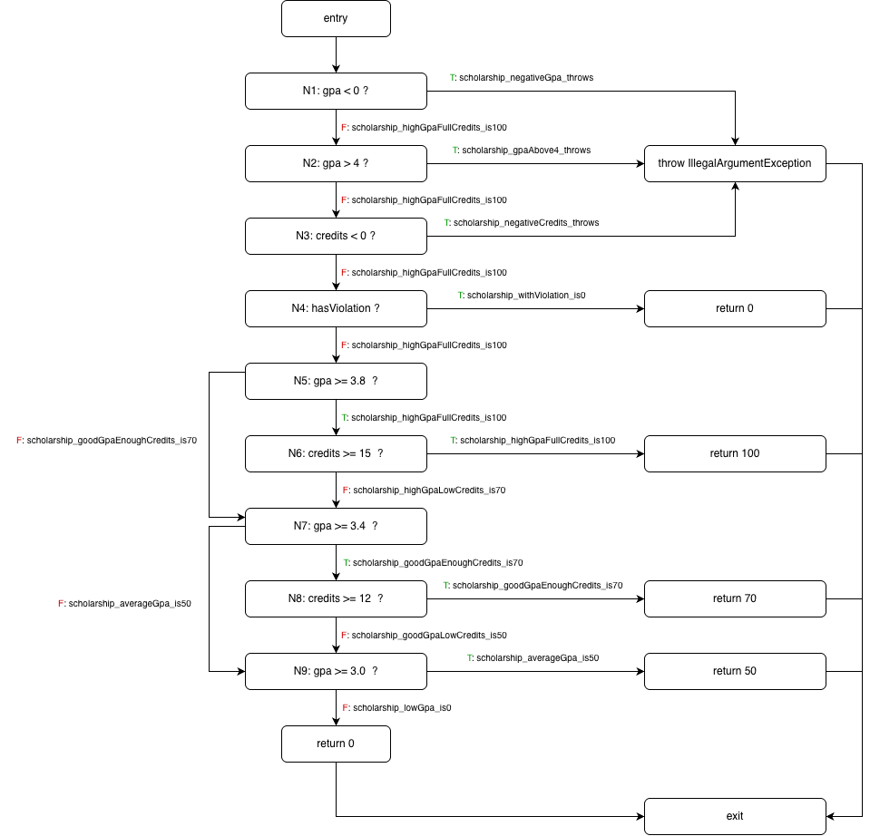

# Лаборатори №9: Код хамралт — JaCoCo-гоор тестээ хөтлөх

- **Нэр:** Г. Тэмүүжин
- **Код:** B232270020

**java --version:**
```
java 17 2021-09-14 LTS
Java(TM) SE Runtime Environment (build 17+35-LTS-2724)
Java HotSpot(TM) 64-Bit Server VM (build 17+35-LTS-2724, mixed mode, sharing)
```

**mvn --version:**
```
Apache Maven 3.9.10 (5f519b97e944483d878815739f519b2eade0a91d)
Maven home: /opt/homebrew/Cellar/maven/3.9.10/libexec
Java version: 17, vendor: Oracle Corporation, runtime: /Library/Java/JavaVirtualMachines/jdk-17.jdk/Contents/Home
Default locale: en_MN, platform encoding: UTF-8
OS name: "mac os x", version: "26.6", arch: "aarch64", family: "mac"
```

## Хэсэг A: Happy path тестүүд ба эхний хэмжилт

**Тестүүд (5, зөвхөн хэвийн урсгал):**

| Тест | Шалгасан зүйл |
|---|---|
| `letterGrade_95_isA` | `letterGrade(95) == "A"` |
| `letterGrade_85_isB` | `letterGrade(85) == "B"` |
| `gpa_95and85_is3point5` | `gpa([95, 85]) == 3.5` |
| `scholarship_highGpaFullCredits_is100` | `scholarship(3.9, 16, false) == 100` |
| `scholarship_goodGpaEnoughCredits_is70` | `scholarship(3.5, 12, false) == 70` |

**Эхний хамралт** (`results/jacoco-A.csv`, `ScholarshipCalculator` класс):

| Хэмжүүр | COVERED | MISSED | Хамралт |
|---|---|---|---|
| Instruction | 99 | 50 | 99/149 ≈ 66.4% |
| Branch | 21 | 20 | 21/41 ≈ 51.2% |
| Line | 15 | 10 | 15/25 = 60.0% |
| Method | 4 | 0 | 4/4 = 100% |

**Шар/улаан мөрүүдийн ажиглалт:** Шар ромботой мөрүүд нь оролтын шалгалтууд (20, 31, 48-р мөр) ба `scholarship`-ийн `&&` нөхцөлүүд (52, 53-р мөр): тестүүд зөвхөн зөв оролт өгсөн тул `score < 0 || score > 100`, `scores == null || scores.length == 0`, `gpa < 0 || gpa > 4 || credits < 0` нөхцөлүүд хэзээ ч үнэн болоогүй, мөн кредит үргэлж хангалттай байсан тул `credits >= 15`, `credits >= 12`-ийн худал салаа хамрагдаагүй; мөн `hasViolation` (51-р мөр) зөвхөн `false`, `gpa`-ийн switch (36-р мөр) зөвхөн A, B дүнгээр явсан. Улаан (огт хүрээгүй) мөрүүд нь гурван алдааны зам — `throw new IllegalArgumentException` (21, 32, 49-р мөр), өөрөөр хэлбэл буруу оноо, null/хоосон массив, хязгаараас гадуурх голч/кредит, мөн `letterGrade`-ийн C/D/F буцаалт (25–27-р мөр), switch-ийн C/D салаа (39–40-р мөр), `scholarship`-ийн 50 ба сүүлийн 0 буцаалт (54–55-р мөр). Өөрөөр хэлбэл happy path тестүүд зөвхөн "сайн оюутан"-ы замыг хамарч, алдааны ба доод түвшний дүнгийн замуудыг бүрэн орхисон.

## Хэсэг B: CFG зурж branch 100% хүрэх

**`scholarship()`-ийн CFG** (draw.io-д гараар зурсан). JaCoCo `||`, `&&`-ийн нөхцөл бүрийг тусдаа салаа гэж тоолдог тул нөхцөл бүрийг тусдаа шийдвэрийн зангилаа (N1–N9) болгосон: 9 шийдвэр × 2 = 18 T/F ирмэг нь JaCoCo-гийн `scholarship()`-д тоолдог 18 салаатай (6 + 2 + 4 + 4 + 2) таарна. Ирмэг бүр дээр түүнийг дайрч буй тестийн метод нэрийг бичсэн:



**Нэмсэн тестүүд (16):**

| Функц | Тест | Хамарсан салаа |
|---|---|---|
| `letterGrade` | `letterGrade_negative_throws`, `letterGrade_above100_throws` | `score < 0`, `score > 100` нөхцөл тус бүрийн үнэн утга (`assertThrows`) |
| `letterGrade` | `letterGrade_75_isC`, `letterGrade_65_isD`, `letterGrade_50_isF` | C / D / F буцаалтууд |
| `gpa` | `gpa_null_throws`, `gpa_emptyArray_throws` | `scores == null`, `scores.length == 0` тус бүрийн үнэн утга (`assertThrows`) |
| `gpa` | `gpa_cdfGrades_is1` | switch-ийн C, D, `default` (F) салаа |
| `scholarship` | `scholarship_negativeGpa_throws`, `scholarship_gpaAbove4_throws`, `scholarship_negativeCredits_throws` | `gpa < 0`, `gpa > 4`, `credits < 0` гурван нөхцөл тус бүрийн үнэн утга (`assertThrows`) |
| `scholarship` | `scholarship_withViolation_is0` | `hasViolation` = true |
| `scholarship` | `scholarship_highGpaLowCredits_is70` | `gpa >= 3.8` үнэн боловч `credits >= 15` худал |
| `scholarship` | `scholarship_averageGpa_is50` | `gpa >= 3.4` худал |
| `scholarship` | `scholarship_goodGpaLowCredits_is50` | `gpa >= 3.4` үнэн боловч `credits >= 12` худал |
| `scholarship` | `scholarship_lowGpa_is0` | `gpa >= 3.0` худал → сүүлийн `return 0` |

**Шаардагдсан тестийн тоо:** нийт **21** тест (Хэсэг A-гийн 5 + Хэсэг B-ийн 16) — `results/mvn-verify-B.txt`: `Tests run: 21, Failures: 0, Errors: 0, Skipped: 0`, `BUILD SUCCESS`.

**Хамралт** (`results/jacoco-B.csv`):

| Хэмжүүр | COVERED | MISSED | Хамралт |
|---|---|---|---|
| Instruction | 149 | 0 | 100% |
| Branch | 41 | 0 | 41/41 = 100% |
| Line | 25 | 0 | 25/25 = 100% |
| Method | 4 | 0 | 100% |

`results/jacoco-B.csv`-д **BRANCH_MISSED = 0**, **LINE_MISSED = 0**.
